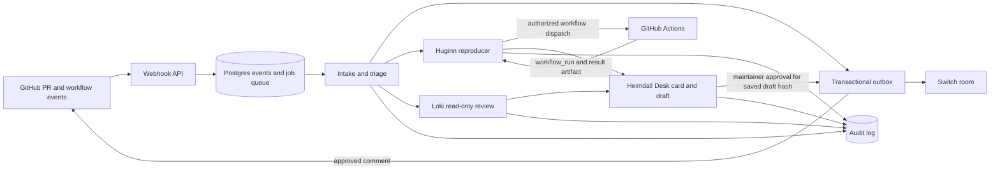

# Heimdall

Heimdall helps maintainers triage open source pull requests. It checks repository rules, tests a
proposed fix, reviews the diff, and prepares a review card in a Mattermost room.

GitHub comments require a maintainer's approval of the exact saved draft. Reproduction runs use a
separate policy authorization tied to the exact workflow request.

## Architecture



### Component Responsibilities

| Component | Module / Adapter | Responsibility |
|---|---|---|
| **Webhook API** | `apps/api` | Verifies GitHub signature, deduplicates on `X-GitHub-Delivery`, persists event, queues triage handling in same transaction |
| **Intake** | `modules/intake` | Applies `heimdall.yml` rules (linked issue, assignee, labels, open-PR limit, CLA, CI) against PR head; stores one result per rule per commit |
| **Triage (state machine)** | `modules/triage` | Owns `prs.state`; only `triage.domain.next_state(...)` may transition state (`received` → `checking` → `card_posted` or `intake_failed`) |
| **Huginn (reproduction)** | `agents/huginn` + `modules/repro` | Runs validated test command on PR head + base via GitHub Actions (`contents: read`, no secrets, `env:` for command); max 3 attempts; submits `HuginnVerdict` |
| **Loki (review)** | `agents/loki` + `modules/review` | Reviews diff with read-only tools; submits up to 5 findings cited `file:line`; tone filter removes speculation |
| **Heimdall (desk)** | `agents/heimdall` + `modules/desk` | Builds Switch summary card from stored results; renders draft replies to `/heimdall` commands; hashes drafts with SHA-256 |
| **Bifröst (bridge)** | `apps/bridge` | Relays Switch room events (reactions, mentions) → application events; records approvals |
| **Gjallarhorn (sender)** | `adapters/github/sender.py` | **Only GitHub writer**; re-checks `draft_hash` matches at post time; posts exact approved text as PR comment |
| **Outbox** | `adapters/db/outbox.py` | Transactional outbox table; idempotency keys; sender delivers with at-least-once semantics |
| **Job Queue** | `adapters/queue` | Procrastinate jobs enqueued in same transaction as state change |
| **Audit Log** | `modules/audit` | Every approval, auto-suggest, repro dispatch appends row in same transaction, scoped to tenant and PR |

### Data Flow

```
GitHub webhook → API (verify + persist) → Triage (next_state)
                                    ↓
                    ┌─────────────────┼─────────────────┐
                    ↓                 ↓                 ↓
              Intake.checks      Huginn.repro       Loki.review
              (plain code)       (GitHub Actions)    (read-only diff)
                    ↓                 ↓                 ↓
              results stored    verdict stored    findings stored
                    └─────────────────┼─────────────────┘
                                      ↓
                            Outbox: checklist, verdict, findings
                                      ↓
                            Switch sender → triage room (threaded)
                                      ↓
                            Maintainer 👍 → Approval row (draft_hash)
                                      ↓
                            Gjallarhorn (hash re-check) → GitHub comment
```

### Module Layout

```
src/heimdall/
  modules/        # one folder per feature (single responsibility)
    tenancy/      # installation, repository, room linking
    triage/       # PR state machine (next_state only)
    intake/       # plain-code rule checks
    repro/        # Huginn reproduction runs
    review/       # Loki review findings
    desk/         # Heimdall card + drafts
    approval/     # draft_hash approval + outbox
    audit/        # audit log
    memory/       # agent memory (notes, preferences)
    conversation/ # thread management
  adapters/       # outside world implementations
    github/       # reader (read-only), sender (Gjallarhorn only writer)
    actions/      # GitHub Actions workflow dispatch + artifacts
    switch/       # Mattermost REST + Switch agent protocol (WebSocket)
    db/           # Postgres engine, UoW, tenant filter, outbox
    ai/           # AiAdapter (provider-agnostic chat)
    queue/        # Procrastinate enqueue helpers
  shared/         # settings, ids, errors, events, logging
```

### Architectural Rules (Enforced by Convention + Review)

1. **Module borders** — Import another module only through its `api.py`. Never reach into `models.py`.
2. **Pure domain** — `domain.py` takes values, returns values. No FastAPI, SQLModel, githubkit, httpx, or adapters.
3. **Ports and adapters** — Services depend on Protocols in `ports.py`. Wiring in `apps/*/main.py`.
4. **One transaction per use case** — Service function commits everything or nothing.
5. **Outbox for side effects** — Never call GitHub/Switch from service. Write outbox row; sender delivers.
6. **Jobs in Postgres** — Procrastinate jobs enqueued in same transaction as state change.
7. **State machine owns PR state** — Only `triage` changes `prs.state`, only via `triage.domain.next_state(...)`.
8. **Tenancy everywhere** — Every table has `installation_id`; every query filters on it; no exceptions.

## Quickstart

You need Docker Compose, an installed Heimdall GitHub App, and a Mattermost/Switch room with a bot
token. Configure the App with `metadata: read`, `contents: read`, `pull requests: read/write`,
`issues: read/write`, `checks: read`, and `actions: read/write`. Subscribe it to `pull_request`,
`workflow_run`, `check_suite`, `installation`, and `installation_repositories` events.

1. Copy the safe template and set the values for your local stack:

   ```bash
   cp .env.example .env
   ```

   Set `HEIMDALL_GITHUB_APP_ID`, `HEIMDALL_GITHUB_WEBHOOK_SECRET`, `HEIMDALL_SWITCH_URL`, and
   `SMEE_URL`, plus the Switch block (admin and registration values; see
   [docs/switch.md](docs/switch.md)). Leave `HEIMDALL_SWITCH_TOKEN` and the two
   `HEIMDALL_DEFAULT_SWITCH_*ROOM_ID` values empty: step 3 fills them in. Create a Smee channel and use its URL as the GitHub
   App webhook URL. Keep the webhook secret the same in GitHub and `.env`.

   Point the agents at a model. One `LLM_DEFAULT_*` block serves all three agents, and any
   provider with an OpenAI-compatible API works:

   ```bash
   LLM_DEFAULT_PROVIDER=openai_compat        # openai_compat | anthropic
   LLM_DEFAULT_BASE_URL=https://openrouter.ai/api/v1
   LLM_DEFAULT_API_KEY=...
   LLM_DEFAULT_MODEL=...
   ```

   To override one agent, set `LLM_<AGENT>_*`. For example, `LLM_LOKI_BASE_URL` and
   `LLM_LOKI_MODEL` move only Loki to a different model family, so its review stays independent.
   See `src/heimdall/adapters/ai/README.md`.

2. Put the downloaded GitHub App private key at `secrets/github-app.pem`. The Compose stack mounts
   it read-only at `/run/secrets/github-app.pem`. Never commit `.env` or `secrets/`.

3. Start the infrastructure, then run the one-off setup. It creates the `triage` channel and a
   Mattermost access token, registers the three agents with Switch, finds Switch's own room id and
   writes `HEIMDALL_SWITCH_TOKEN`, `HEIMDALL_DEFAULT_SWITCH_ROOM_ID` and
   `HEIMDALL_DEFAULT_SWITCH_AGENT_ROOM_ID` to `.env`. It is safe to re-run.

   ```bash
   docker compose up -d
   uv run python -m apps.bridge.setup          # add --print to also show the token
   ```

   Every repo the App is installed on is linked to those rooms. To move one repo later, run
   `python -m apps.admin.link_room <installation_id> <repo_id> <room_id> --agent-room-id <uuid>`.

4. Start the stack:

   ```bash
   docker compose --profile app --profile tunnel up -d --build
   ```

   Compose adds the migrations, the API, worker, MCP server, bridge, the three agents and the
   Smee forwarder to the infrastructure already running. The API listens at `http://localhost:8001`;
   Mattermost listens at `http://localhost:8065`; Switch listens at `http://localhost:8000` with
   its admin UI at `http://localhost:3000`. See [docs/switch.md](docs/switch.md) for the Switch details.

5. Install the GitHub App on a repository with Actions enabled. Open or update a PR and check its
   thread in the `triage` room. Completed reproduction workflows return through the `workflow_run`
   webhook and their paired result artifact.

The reproduction workflow has `contents: read`, receives no secrets, and checks out the head and
base commits separately. Its test command is passed through an environment variable.

## Repository configuration

Heimdall reads configuration from two optional files, then validates the merged result:

1. Built-in defaults.
2. `.github/heimdall.yml` in the owner's `.github` repository, read from that repository's default
   branch.
3. `heimdall.yml` in the pull request repository, read at the PR head commit.

Later layers override earlier values. Maps merge by key; lists and scalar values replace the earlier
value. Unknown keys are errors. The test command must use one of the configured allowed runners;
Huginn cannot change the runner.

```yaml
version: 1
maintainers: []
intake:
  require_linked_issue: true
  require_assignee: true
  required_labels: []
  max_open_prs_per_author: 5
  require_cla: false
  require_ci_green: true
repro:
  test_cmd: "pytest -q"
  allowed_runners: [pytest]
  source_paths: [src/]
  workflow: heimdall-repro.yml
review:
  max_findings: 5
  skip_paths: ["docs/**", "*.md"]
auto_suggest:
  enabled: true
  categories: [lint, typo, rename, missing_import, docstring, changelog]
room:
  switch_room: triage
```

`maintainers` defaults to an empty list, so Desk commands are disabled until repository maintainers
are configured. The schema, defaults, and validation errors are documented in
[`src/heimdall/modules/tenancy/README.md`](src/heimdall/modules/tenancy/README.md).

## Security and approval

- PR titles, descriptions, diffs, comments, and test output are untrusted data. Agents never treat
  them as instructions or pass them to a shell.
- GitHub comments go through the approval outbox. Gjallarhorn checks that an approval exists for
  the exact draft hash immediately before sending.
- Workflow dispatch goes through the GitHub outbox with a separate authorization record whose hash
  covers the repository, workflow, branch ref, and inputs.
- Reproduction Actions have read-only repository permissions and no secrets. The validated test
  command is supplied through `env`, not interpolated into a shell script.
- Webhook signatures are verified before the request body is read, and delivery IDs deduplicate
  retries.
- `.env` and the GitHub App private key are local secrets; keep them out of commits and logs.

## Agentic runtime

Huginn, Loki and Heimdall run on the shared agentic runtime in `agents/_runtime.py`. The model
chooses its steps; the runtime's ToolBox, budgets, guardrails and `submit_*` tools decide what it
may do and what a finished answer looks like. The runtime never posts; the caller turns the
outcome into a room card through the outbox.

- **Huginn** consumes `huginn.run_repro` and submits a `HuginnVerdict`
  (`reproduced` / `not_covered` / `setup_failed` / `inconclusive`).
- **Loki** consumes `loki.run_review` and submits a `LokiReview` (saved finding ids or a skip
  reason).
- **Heimdall** consumes `heimdall.build_card` and `heimdall.run_command` and submits a
  `DeskResult` (`card`, `draft`, `mechanical_task` or `explanation`).

Each agent loads playbooks from `agents/<name>/skills/*.md` at startup and exposes a local
`load_skill` tool; the system prompt carries only a name + description index. The runtime
contract, skill format and startup validation are in `agents/README.md`.

The existing outbox path, approval hash and GitHub write rules are unchanged. Agent tests live
under `tests/unit/agents/`.

## Development and tests

```bash
uv sync
uv run ruff check .
uv run ruff format --check .
uv run pyright
uv run pytest tests/unit
```

Integration tests use Postgres. Start it with `docker compose up -d postgres`, set `DATABASE_URL`
to the local Heimdall database, then run:

```bash
DATABASE_URL=postgresql://heimdall:<password>@localhost:5432/heimdall uv run pytest tests/integration
```

The end-to-end replay runs the three seeded demo PRs (#3 good fix, #4 fake fix, #5 rule breaker)
through the whole pipeline: webhooks, both worker queues, the outbox, the MCP tool server, the
agents' own loops and the 👍 approval. GitHub and Switch are faked from responses recorded off
the demo repo (`tests/fixtures/e2e/`), and only Loki's model reply is scripted. It uses the same
Postgres:

```bash
DATABASE_URL=postgresql://heimdall:<password>@localhost:5432/heimdall uv run pytest tests/e2e -m e2e
```

The CI workflow runs lint, formatting, Pyright, unit tests, database integration tests and the
end-to-end replay on pushes and pull requests.

## Why Mattermost + Switch AI?

Heimdall runs on **Mattermost with Switch AI** — the open-source agent platform that turns a Mattermost channel into a **room** where AI agents and human maintainers work together with shared context. We self-host Mattermost and Switch (via Docker Compose) so all data stays on your infrastructure.

### What Heimdall implements on Switch

**1. Three agents as first-class room participants**
Each agent (Huginn, Loki, Heimdall) registers with Switch via the agent protocol (WebSocket), getting its own identity, API key, and persistent connection. They:
- Post threaded replies under their own name in the `triage` room
- Receive mentions and respond in real-time (e.g., `@loki review this`)
- Maintain connections with automatic reconnection and cursor tracking

**2. One thread per PR**
Heimdall opens a thread per PR in the `triage` room. The initial triage card is the root; all updates — intake checklist, Huginn's verdict, Loki's findings, Heimdall's draft — reply in that thread. The entire PR context stays in one place.

**3. Built-in authentication, authorization, and approval cards**
The `apps.bridge.setup` command handles:
- Agent registration (keys in `secrets/switch-agents.env`, never printed)
- Addressing policies — only people in the triage room can mention agents
- Mattermost channel ↔ Switch room linkage
- **Approval cards** — native Switch UI for human-in-the-loop decisions (used by Heimdall's 👍 approval flow)

**4. Separation: agents vs. infrastructure**
- **Agents** run as independent processes, each with its own Switch WebSocket. They only `submit_*` results.
- **Worker** posts results via the transactional outbox, using each agent's identity.
- **Bridge** (Bifröst) relays 👍 reactions and commands back into the app.
A compromised agent cannot post as another; the outbox guarantees idempotent delivery.

**5. Provider-agnostic AI**
Heimdall's agents use a provider-agnostic `AiAdapter` (config via `LLM_DEFAULT_*` / `LLM_<AGENT>_*`). Switch ships no models — you bring your own (Claude Code, Codex, OpenCode, or any OpenAI-compatible API). Switching models is a config change, never a code change.

**6. Self-hosted, no vendor lock-in**
Mattermost + Switch run on your infrastructure (Docker Compose, Postgres). No SaaS dependency, no data leaves your network. You own the conversation history, agent keys, and approval audit trail.

**7. Proven pattern for open-source maintainer workflows**
The Switch AI ["Open source: review a contribution" use case](https://docs.switchagents.ai/switch-rooms/use-cases/open-source-contribution) describes this pattern. The [Flip the Switch hackathon](https://dev.to/yash_thokal_a1899d36b0351/i-gave-my-github-repo-an-ai-triage-team-that-cant-do-anything-without-my-yes-1h6n) produced "Maintainer Desk" and "Issue Desk" projects on Switch implementing the same human-in-the-loop triage pattern Heimdall automates at scale.

---

## Best Use Case: Hash-Bound PR Triage with Human-in-the-Loop

The **killer use case** Heimdall implements is **end-to-end PR triage where AI does the work but humans keep the authority** — enforced cryptographically.

### The flow
1. **Intake** (plain code) checks: linked issue, labels, assignee, CLA, CI — results posted to the PR thread
2. **Huginn** runs the repo's test command on PR head + base commit on GitHub Actions (read-only, no secrets) → paired verdict
3. **Loki** reviews the diff with read-only tools → up to 5 findings, each cited `file:line`
4. **Heimdall (Desk)** builds a summary card + draft reply, hashes the draft with SHA-256
5. **Maintainer** reacts 👍 to the draft in Switch → approval row recorded with `draft_hash`
6. **Gjallarhorn** (the only GitHub writer) re-checks the hash matches *at posting time* → posts comment

### Why this is the best use case
| Property | How it's achieved |
|----------|-------------------|
| **No unsupervised AI writes** | Only Gjallarhorn writes; only with matching `draft_hash` |
| **Maintainer keeps final say** | 👍 reaction on exact draft text; edited draft = hash mismatch = no post |
| **Audit trail** | Every approval, auto-suggest, repro dispatch logged in same transaction |
| **Reproducible verification** | Huginn's paired runs (with/without fix) stored as artifacts |
| **Grounded reviews** | Loki's findings cite `file:line`; tone filter removes speculation |
| **Fits existing workflow** | Runs in your Mattermost/Switch, uses your GitHub App, your test command |

### What makes it unique
- **Hash-binding at post time, not draft time** — a revised draft can never slip out under an old approval
- **Auto-suggest still goes through approval** — mechanical fixes (lint, typo, missing import) use `approver = "policy:auto_suggest"` but still require a hash-matched approval row
- **Reproduction is isolated** — GitHub Actions workflow gets `contents: read` only, test command via `env`, no `pull_request_target`
- **Tenancy everywhere** — every table has `installation_id`; every query filters on it; no cross-repo leakage

This use case — **AI-assisted triage with cryptographic human approval** — is what Heimdall was built for. Everything else (module architecture, outbox, state machine, agent runtime) exists to make this flow reliable, auditable, and secure.

---

## Documentation

`docs/index.md` is the single navigation page for all Heimdall documentation: how it works,
setup, architecture, configuration, security, development, and agents. Each scoped README
(`src/heimdall/modules/*/README.md`, `src/heimdall/adapters/*/README.md`, `apps/*/README.md`,
`agents/README.md`) describes its own folder in detail.