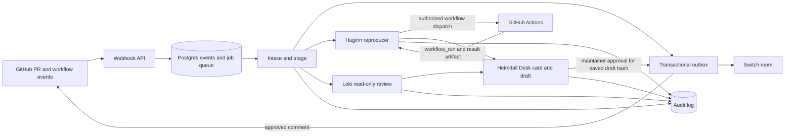

# Heimdall

Heimdall helps maintainers triage open source pull requests. It checks repository rules, tests a
proposed fix, reviews the diff, and prepares a review card in a Mattermost room.

GitHub comments require a maintainer’s approval of the exact saved draft. Reproduction runs use a
separate policy authorization tied to the exact workflow request.

## Architecture



| Component | Responsibility |
|---|---|
| Intake | Applies the repository’s `heimdall.yml` rules and records the result for the PR head. |
| Huginn | Runs the configured test command against the PR and base commits, then reports paired results. |
| Loki | Reviews the current diff with read-only tools and submits findings tied to changed lines. |
| Heimdall | Summarizes stored results in a card and routes supported maintainer commands. |
| Bifröst | Relays Switch room events and maintainer commands into application events. |
| Gjallarhorn | Sends an approved GitHub comment only while the saved draft hash still matches. |

## Quickstart

You need Docker Compose, an installed Heimdall GitHub App, and a Mattermost/Switch room with a bot
token. Configure the App with `metadata: read`, `contents: read`, `pull requests: read/write`,
`issues: read/write`, `checks: read`, and `actions: read/write`. Subscribe it to `pull_request`,
`workflow_run`, `check_suite`, `installation`, and `installation_repositories` events.

1. Copy the safe template and set the values for your local stack:

   ```bash
   cp .env.example .env
   ```

   Set `HEIMDALL_GITHUB_APP_ID`, `HEIMDALL_GITHUB_WEBHOOK_SECRET`, `HEIMDALL_SWITCH_URL`,
   `HEIMDALL_SWITCH_TOKEN`, and `SMEE_URL`. Create a Smee channel and use its URL as the GitHub
   App webhook URL. Keep the webhook secret the same in GitHub and `.env`.

   Point the agents at a model. One `LLM_DEFAULT_*` block serves all three agents, and any
   provider with an OpenAI-compatible API works:

   ```bash
   LLM_DEFAULT_PROVIDER=openai_compat        # openai_compat | anthropic
   LLM_DEFAULT_BASE_URL=https://openrouter.ai/api/v1
   LLM_DEFAULT_API_KEY=...
   LLM_DEFAULT_MODEL=...
   ```

   To override one agent, set `LLM_<AGENT>_*`. For example, `LLM_LOKI_BASE_URL` and
   `LLM_LOKI_MODEL` move only Loki to a different model family, so its review stays independent.
   See `src/heimdall/adapters/ai/README.md`.

2. Put the downloaded GitHub App private key at `secrets/github-app.pem`. The Compose stack mounts
   it read-only at `/run/secrets/github-app.pem`. Never commit `.env` or `secrets/`.

3. Create the `triage` room in Switch and give the configured bot access. The default
   `heimdall.yml` room name is `triage`.

4. Start the stack:

   ```bash
   docker compose up --build
   ```

   Compose starts Postgres, Mattermost, migrations, the API, worker, MCP server, bridge, the three
   agents, and the Smee forwarder. The API listens at `http://localhost:8000`; Mattermost listens
   at `http://localhost:8065`.

5. Install the GitHub App on a repository with Actions enabled. Open or update a PR and check its
   thread in the `triage` room. Completed reproduction workflows return through the `workflow_run`
   webhook and their paired result artifact.

The reproduction workflow has `contents: read`, receives no secrets, and checks out the head and
base commits separately. Its test command is passed through an environment variable.

## Repository configuration

Heimdall reads configuration from two optional files, then validates the merged result:

1. Built-in defaults.
2. `.github/heimdall.yml` in the owner’s `.github` repository, read from that repository’s default
   branch.
3. `heimdall.yml` in the pull request repository, read at the PR head commit.

Later layers override earlier values. Maps merge by key; lists and scalar values replace the earlier
value. Unknown keys are errors. The test command must use one of the configured allowed runners;
Huginn cannot change the runner.

```yaml
version: 1
maintainers: []
intake:
  require_linked_issue: true
  require_assignee: true
  required_labels: []
  max_open_prs_per_author: 5
  require_cla: false
  require_ci_green: true
repro:
  test_cmd: "pytest -q"
  allowed_runners: [pytest]
  source_paths: [src/]
  workflow: heimdall-repro.yml
review:
  max_findings: 5
  skip_paths: ["docs/**", "*.md"]
auto_suggest:
  enabled: true
  categories: [lint, typo, rename, missing_import, docstring, changelog]
room:
  switch_room: triage
```

`maintainers` defaults to an empty list, so Desk commands are disabled until repository maintainers
are configured. The schema, defaults, and validation errors are documented in
[`src/heimdall/modules/tenancy/README.md`](src/heimdall/modules/tenancy/README.md).

## Security and approval

- PR titles, descriptions, diffs, comments, and test output are untrusted data. Agents never treat
  them as instructions or pass them to a shell.
- GitHub comments go through the approval outbox. Gjallarhorn checks that an approval exists for
  the exact draft hash immediately before sending.
- Workflow dispatch goes through the GitHub outbox with a separate authorization record whose hash
  covers the repository, workflow, branch ref, and inputs.
- Reproduction Actions have read-only repository permissions and no secrets. The validated test
  command is supplied through `env`, not interpolated into a shell script.
- Webhook signatures are verified before the request body is read, and delivery IDs deduplicate
  retries.
- `.env` and the GitHub App private key are local secrets; keep them out of commits and logs.

## Development and tests

```bash
uv sync
uv run ruff check .
uv run ruff format --check .
uv run pyright
uv run pytest tests/unit
```

Integration tests use Postgres. Start it with `docker compose up -d postgres`, set `DATABASE_URL`
to the local Heimdall database, then run:

```bash
DATABASE_URL=postgresql://heimdall:<password>@localhost:5432/heimdall uv run pytest tests/integration
```

The CI workflow runs lint, formatting, Pyright, unit tests, and database integration tests on pushes
and pull requests.

## Demo

The demo recording is not available yet. The recording task is tracked in
[HEI-75](https://linear.app/heimdallabs/issue/HEI-75/record-the-demo-video-about-3-minutes); add
the video URL here after it is recorded.
